<div align="center">

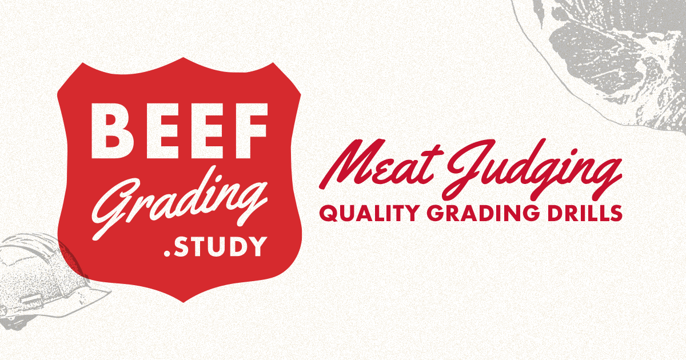

# beefgrading.study

**Look at the ribeye. Call the grade. Get scored.**
A free USDA beef quality-grading drill for FFA, 4-H and collegiate meat judging.

[](https://github.com/Trashy-Panda/quality_grading/actions/workflows/deploy-pages.yml)
[](https://beefgrading.study)

</div>

## What it is

beefgrading.study is a practice site for people learning to call USDA quality grades on beef ribeye photos. A student looks at a carcass photo, picks one of the nine grades from Prime down to Standard, and sees how close the call was. Coaches get a weekly challenge with a leaderboard. Collegiate teams get power rankings built from real contest results. A separate phone app scores wool-judging bubble sheets.

The site is plain HTML, CSS and JavaScript with no build step. GitHub Pages serves it and Firebase handles sign-in and shared data. Live at **<https://beefgrading.study>**.

<table>
  <tr>
    <td valign="top">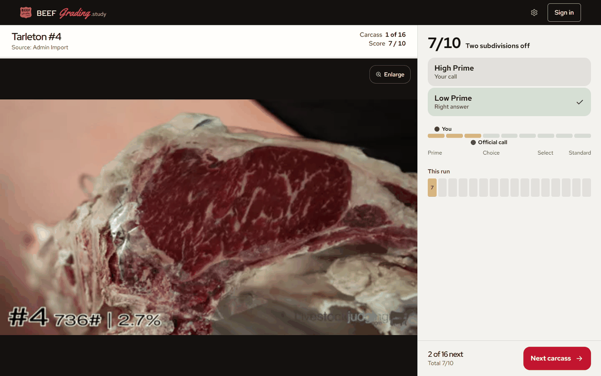</td>
    <td valign="top">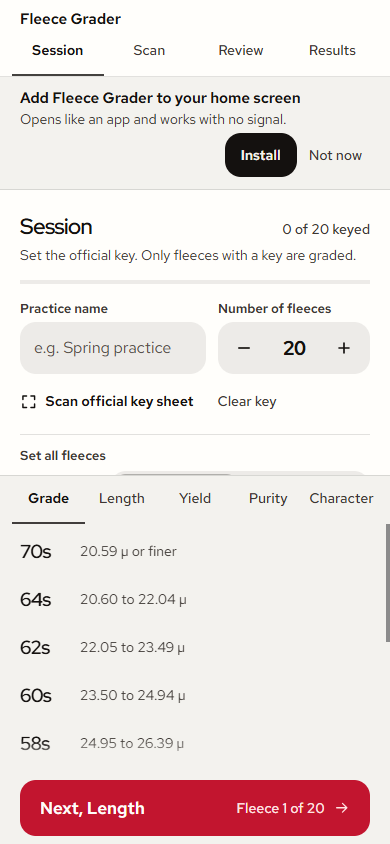</td>
  </tr>
  <tr>
    <td align="center"><sub>The drill after an answer: what you called, the official call, the score.</sub></td>
    <td align="center"><sub>The fleece grader, installed on a phone.</sub></td>
  </tr>
</table>

## Contents

- [Features](#features)
- [How it works](#how-it-works)
- [Design decisions](#design-decisions)
- [Repository map](#repository-map)
- [Run locally](#run-locally)
- [Deploy](#deploy)
- [Contributing](#contributing)
- [Credits](#credits)
- [License](#license)

## Features

### Quality-grading drill

Pick Practice or This week on the setup screen, then work through a deck of ribeye photos. Each answer is scored by distance on the nine-grade ladder (High Prime, Average Prime, Low Prime, High Choice, Average Choice, Low Choice, High Select, Low Select, Standard). The scoring function is `scoreQuality` in [`app.js`](beefgrading.study/app.js):

| Steps off the official call | Points |
|---|---|
| 0 | 10 |
| 1 | 9 |
| 2 | 7 |
| 3 | 4 |
| 4 or more | 0 |

High Choice and Low Prime are neighbours on the ladder, so one subdivision across the Choice/Prime boundary costs one step, not more. The drill only covers A-maturity carcasses, so the two collegiate-only grades (Average Select and Commercial) are not asked for. A field guide page lays out the nine callable grades.

<table>
  <tr>
    <td valign="top">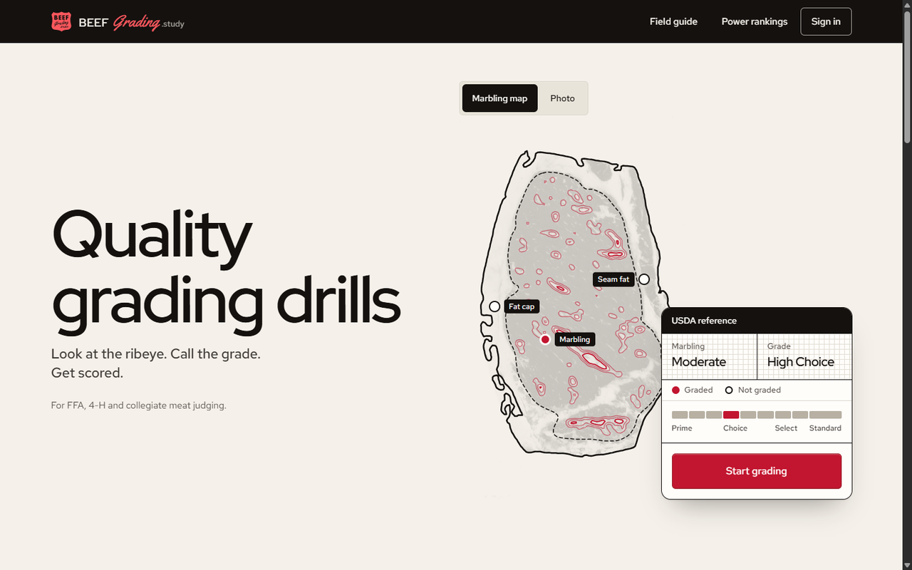</td>
    <td valign="top">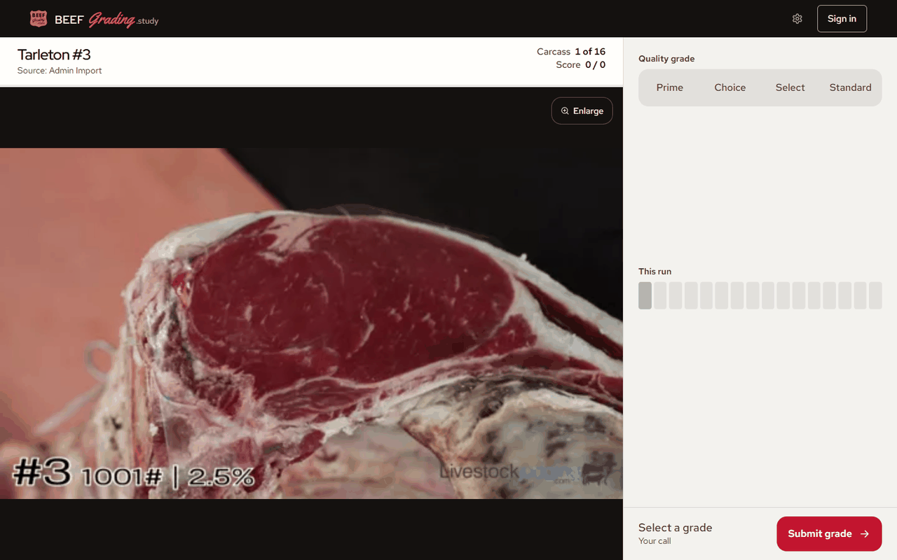</td>
  </tr>
</table>

The seven USDA marbling reference photographs the site and the AI grader use as anchors, from Slight to Abundant:

<table>
  <tr>
    <td align="center">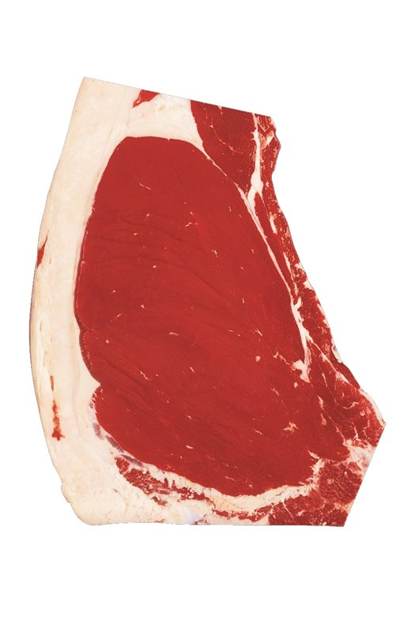<br><sub>Slight</sub></td>
    <td align="center">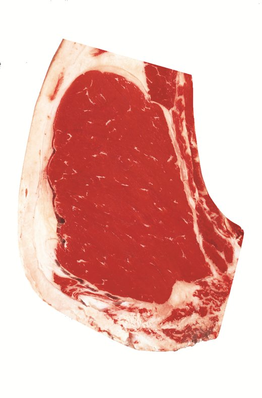<br><sub>Small</sub></td>
    <td align="center">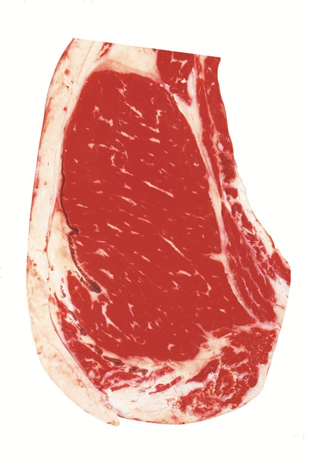<br><sub>Modest</sub></td>
    <td align="center">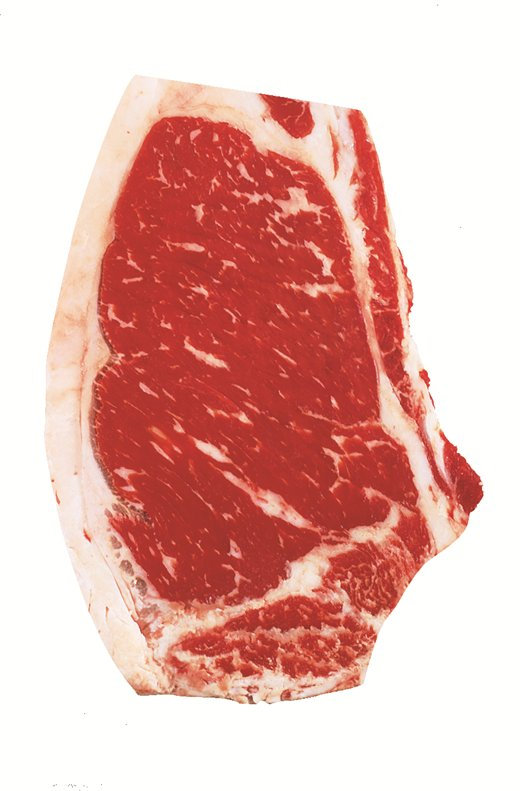<br><sub>Moderate</sub></td>
    <td align="center">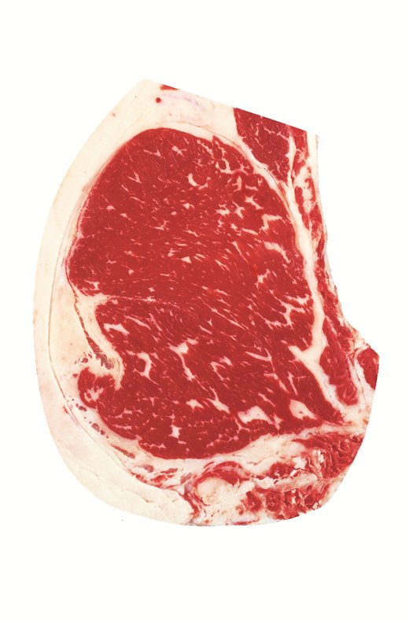<br><sub>Slightly Abundant</sub></td>
    <td align="center">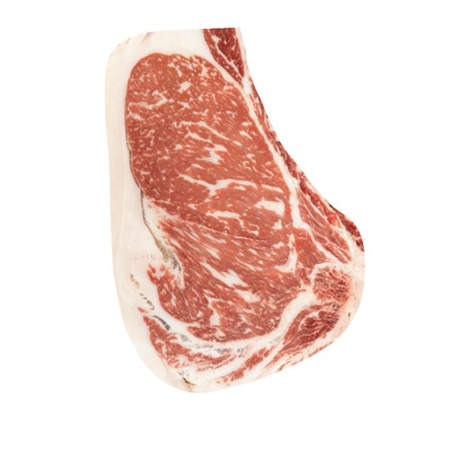<br><sub>Moderately Abundant</sub></td>
    <td align="center">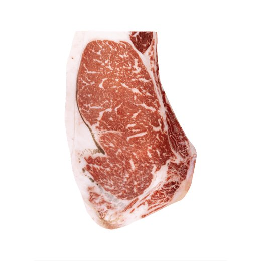<br><sub>Abundant</sub></td>
  </tr>
</table>

**Why it exists:** meat judging is learned by calling many carcasses against fixed references and getting told how far off you were. A distance-based score gives partial credit for a near miss instead of treating every wrong answer the same.

### Weekly challenge and leaderboard

Each week, an admin sets a deck of carcasses. Signed-in users (Google or GitHub) get one attempt per week and per division (High school or College). Weeks run Monday to Sunday UTC (`getWeekBounds` in [`weekly.js`](beefgrading.study/weekly.js)). The leaderboard shows the field's spread as one dot per grader, then ranks by percentage, with ties sharing a rank. The division only decides which leaderboard an entry lands on; both divisions are scored on the same ladder.

If no deck is configured for the week, the page shows an empty state. It never falls back to placeholder photos.

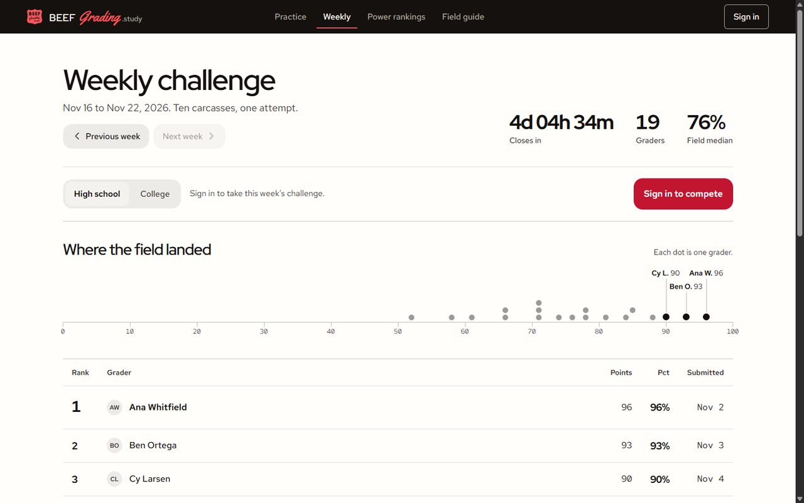

<sub>Sample data from the local `?wktest` test fixture, not real results.</sub>

**Why it exists:** a shared deck and a deadline let a class or chapter compare scores.

### Power rankings

Rankings for collegiate meat judging teams and individuals, by season and by division (senior or junior colleges), with category views such as beef grading and reasons. The ratings are computed in the browser from raw contest results in Firestore (`meat_contests`). The method adapts the Official World Golf Ranking approach used by livestockjudging.com's collegiate rankings:

- A contest's strength is the average rating of its top finishers, and placements convert to convex points, so winning counts for a lot.
- A team's rating is the mean of its top 5 real results this season, or all of them if it has fewer. Missing results are not padded.
- The International carries a 2x weight, applied to how far a result sits from the field average rather than to the raw number, so attending does not outscore winning elsewhere.
- A team gets a numbered rank once it has `min(3, most contests anyone played that season)` real results. Thinner records are listed separately with their actual results.

Offline Python scripts load the data: `ingest_judgingcard.py` scrapes a contest, `ingest_scorecards.py` adds individuals and category splits, `ingest_historic.py` parses the 100 Years of Meat Judging archive, and `push_contests.py` uploads to Firestore. Details and the reasons for each choice are in [`powerrankings/README.md`](beefgrading.study/powerrankings/README.md).

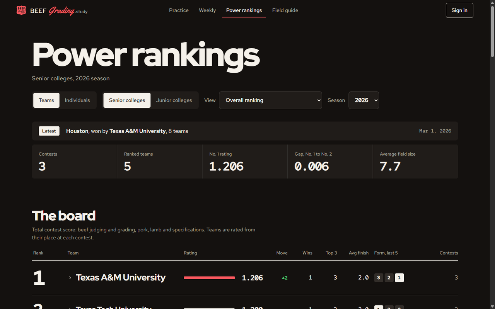

<sub>Sample data from the built-in `#prtest` fixture, not live standings.</sub>

**Why it exists:** it puts a season's contest results on one ranked board.

### Fleece grader (offline phone add-on)


A separate installable web app at [`/fleece/`](beefgrading.study/fleece/) for wool judging. It takes a phone photo of the grading-rail bubble sheet (20 fleeces, 38 bubbles each), reads the marks, and scores the sheet against an official key. Each fleece is worth 20 points (grade 6, length 4, yield 6, purity 2, character 2), so a 20-fleece sheet is out of 400. The rules live in [`scoring.js`](beefgrading.study/fleece/scoring.js) and are specified in [`fleece-grader/SPEC.md`](fleece-grader/SPEC.md).

- **Four tabs:** Session (set the official key), Scan, Review, Results.
- **Key:** typed in, or scanned from the official's bubbled sheet. A grader's slash on a student sheet that disagrees with the key is flagged for a look.
- **Reading the sheet:** OpenCV.js finds the sheet by its ruled table lines, then samples each bubble. Marks that read twice or not at all are flagged on the photo and in Review.
- **Offline:** a service worker precaches the app, OpenCV.js and the fonts, so it works with no signal once installed.
- **Handwriting readers (offline, committed as modules):** `digits.js` reads the handwritten "Written" yield digits and the official yield written in a row's margin, using a 24 KB digit classifier in `vendor/` (`digits-net.bin`). The commit message reports 94.3% on written digits, 85.9% on margin digits and 1.5% confident errors, measured on held-out sheets. `listkey.js` reads a handwritten list key, one fleece per line ("62  S  54"), and reports `nolist` for a page that is not a list; it got 20 of 20 on the sample list key. The readers are advisory (bubbles still decide), `omr.js` hand crops are opt-in, and the committed app does not call them yet.
- **Built, not yet in the UI:** a plurality-vote key builder across a stack of graded sheets (`consensus.js`), saved classes (`rails.js`), a 120-character key codec (`keycodec.js`) and an online module for posting official keys (`online.js`). Unit tests cover them. Posting keys also needs the `fleece_keys` Firestore rules published, which the commit history marks as not yet done.

**Why it exists:** practice sheets for wool judging get scored by hand. A scanner on a phone that works without signal replaces that.

### AI grader (offline pipeline)

[`beefgrading.study/grader/`](beefgrading.study/grader/) holds the Python pipeline that produces the seed carcasses. It runs on a developer machine and the site never executes it.

1. `grade_ribeyes.py` takes ribeye photos from the TTU meat-judging dataset (about 2,857 images).
2. `model_utils.py` asks Claude vision to place each photo against seven fixed USDA marbling reference photos. Claude reports a marbling degree and subunit, not a grade. Three calls per image, median score, then an optional calibration offset.
3. Plain code turns the score into a grade with fixed thresholds (900 and up is High Prime, 800 is Average Prime, and so on down to under 300 as Standard).
4. If the model's replies cannot be parsed, the image is marked `needs_review`. The code never invents a grade.
5. Photos go to Cloudinary and the grade to the Firestore `ai_carcasses` collection.
6. On the site, users vote on those photos ("Help grade practice images"). An admin can promote a photo to the practice deck once it has 5 or more votes.

`build_trainer.py` and `recalibrate.py` let a person correct the grader's calls and fit the offset. The full audit, the reasons for the rebuild and the evaluation plan are in [`AUDIT_AND_REDESIGN.md`](beefgrading.study/grader/AUDIT_AND_REDESIGN.md); day-to-day commands are in [`grader/README.md`](beefgrading.study/grader/README.md).

**Why it was rebuilt:** the first Claude-based grader asked for a grade directly from a small thumbnail. Across 50 carcasses it only ever answered 3 of the 9 grades and agreed exactly with human votes 25% of the time on the 20 images that had votes. Its calibration photos also came from earlier AI-graded images, which fed its own bias back in.

### Admin panel

[`admin.html`](beefgrading.study/admin.html) is for the site admin only. Tabs: Leaderboard, Weekly Challenge, Users, Community, Grading Votes, Analytics and Power Rankings (contest import and manual entry). The admin is identified by one Firebase UID, checked both in `admin.js` and in `firestore.rules`.

## How it works

The browser loads static files from GitHub Pages and talks to Firebase for sign-in and data. The Python tools and the fleece app sit around that core.

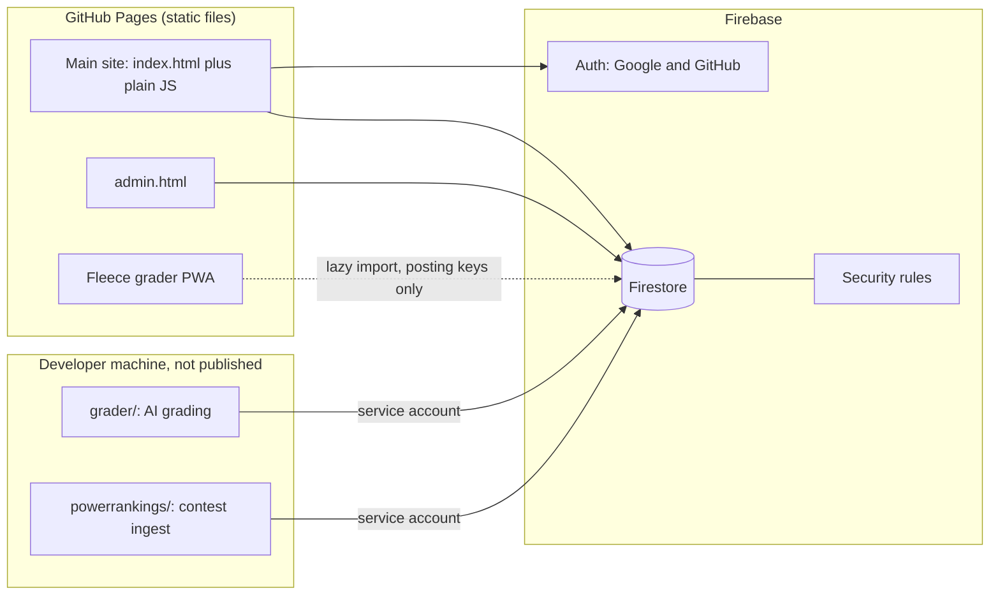

Two data paths feed the screens: AI-graded photos reach the drill through crowd votes, and contest results reach the rankings.

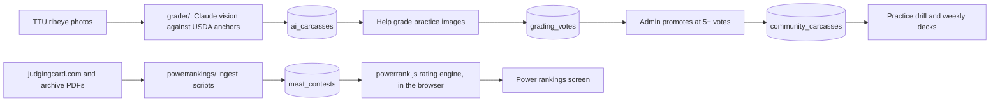

## Design decisions

Each entry gives the decision, the reason, and the cost. The sources are in the repo.

1. **No build step, no npm.** The site is served as written. Reason: the simplest thing to host on GitHub Pages and nothing to keep patched ([`CLAUDE.md`](CLAUDE.md)). Cost: no bundler or shared modules, so `app.js`, `leaderboard.js` and `powerrank.js` each carry their own screen router. The rule is to grep before renaming any id ([`.claude/rules/frontend.md`](.claude/rules/frontend.md)).
2. **Firebase is the only backend.** A static site still needs shared scores, sign-in and admin data, and Firebase has a free tier ([`docs/NOTES.md`](beefgrading.study/docs/NOTES.md)). Cost: anything a rule cannot check has to be trusted from the client.
3. **`FIREBASE_CONFIG` is public in `data.js`.** It is an identifier, not a secret. Access is enforced by Auth and security rules, and moving it to `.env` would add a build step for no gain ([`data.js`](beefgrading.study/data.js), lines 15 to 22).
4. **The rules are the real gate.** Each collection has explicit read, create, update and delete rules with no wildcards ([`firestore.rules`](beefgrading.study/firestore.rules)). The client admin check is only for show. Limits are stated in the file: for a weekly score, the rules check that the percentage matches earned over max, but both numbers come from the client, and a per-carcass answer log is stored for analytics only. One attempt per week is held by writing to a deterministic id (`{uid}_{weekId}_{ruleSet}`) with updates denied; the rule does not force every client to use that id. The owner publishes rules by hand in the Firebase Console.
5. **Ladder-distance scoring.** One scale on nine grades gives partial credit for near misses (see the drill section above). The old split between FFA and collegiate scoring was removed, and the rule set now only routes leaderboard entries.
6. **Never serve placeholder carcasses.** If no real deck exists, the page says so. A placeholder image with a made-up answer teaches the wrong grade (commit `fd37098`).
7. **Measure, then grade.** The AI grader outputs a marbling measurement against fixed USDA anchors and code assigns the grade. Anchor photos are scored at their band floors, as the USDA standards describe them, and the grader no longer calibrates against its own earlier output (commit `5f09ce0`, [`model_utils.py`](beefgrading.study/grader/model_utils.py)).
8. **Votes do not auto-promote.** A crowd-voted image becomes a practice carcass only when an admin promotes it with at least 5 votes (`GV_MIN_VOTES` in `admin.js`). Cost: the practice pool grows at the pace of admin review.
9. **Offline-first fleece app, with vendored dependencies.** OpenCV.js and the fonts ship with the app and a service worker precaches them, because the use case is a phone with poor signal. Firebase is imported lazily and only when posting a key. Cost: the service worker serves cached files first, so every fleece release must bump the version in `sw.js`.
10. **Register the sheet on its ruled lines.** The reader aligns to the sheet's ruled table lines, not to the faint dotted bubble outlines ([`omr.js`](beefgrading.study/fleece/omr.js) header, [`SPEC.md`](fleece-grader/SPEC.md)). Unsure marks are flagged instead of guessed.
11. **Rank in the browser, from raw results.** Contests are stored as raw placements, so a method change is a code change, not a data migration. The method is an adaptation of an existing public approach rather than a new invention, and it refuses to guess for teams with thin records ([`powerrankings/README.md`](beefgrading.study/powerrankings/README.md)).
12. **One token file, hard UI rules.** Design tokens live in `style.css` `:root`. The v3 system is "the thing you are judging is the stage": the photo or sheet fills the screen and controls sit on one surface ([`docs/DESIGN.md`](beefgrading.study/docs/DESIGN.md)). No scroll listeners, transform and opacity only for animation, and a reduced-motion path for every animation.
13. **`dev` and `master`, with a gate.** `master` deploys on push, so nothing reaches it without an explicit go and a security review ([`CLAUDE.md`](CLAUDE.md), [`.claude/hooks/guard-master.mjs`](.claude/hooks/guard-master.mjs)).
14. **Publish only the site.** The workflow copies `beefgrading.study/` but leaves out `docs/`, `deployment/`, `grader/`, Python files and READMEs (commit `da2b148`). Tooling and notes stay in the repo without going live.

## Repository map

<details>
<summary>Top-level folders and what ships</summary>

| Path | What it is | Published to the live site |
|---|---|---|
| [`beefgrading.study/`](beefgrading.study/) | The site: HTML, CSS, JS, assets, `firestore.rules` | Yes, minus the exclusions below |
| [`beefgrading.study/fleece/`](beefgrading.study/fleece/) | The fleece grader PWA | Yes, at `/fleece/` |
| [`beefgrading.study/grader/`](beefgrading.study/grader/) | AI grading pipeline (Python) | No |
| [`beefgrading.study/powerrankings/`](beefgrading.study/powerrankings/) | Contest ingest scripts and data (Python, JSON) | No |
| [`beefgrading.study/docs/`](beefgrading.study/docs/) | Design system, setup notes, README images | No |
| [`beefgrading.study/deployment/`](beefgrading.study/deployment/) | `deploy.bat`, local dev server | No |
| [`fleece-grader/`](fleece-grader/) | Fleece spec, dev pages and tests. Private scanned sheets stay local and are gitignored | No |
| [`.claude/`](.claude/) | Claude Code settings, rules, the `security-auditor` agent, the master-branch guard hook, screenshot tool | No |
| [`.github/workflows/`](.github/workflows/deploy-pages.yml) | The Pages deploy workflow | No |

The workflow leaves out `.hallmark/`, `docs/`, `deployment/`, `grader/`, `__pycache__/`, `*.py` and `README.md`.

</details>

## Run locally

Everything below runs from a clone with no install step for the site itself.

```bash
# Site (no-cache dev server on http://localhost:8000)
cd beefgrading.study
python deployment/devserver.py

# Fleece grader dev server (from beefgrading.study)
python ../fleece-grader/dev/devserver.py 8012

# Fleece tests (from the repo root; the directory form fails on Node 25)
node --test fleece-grader/tests/*.test.mjs
```

Test hooks for screens that need data or sign-in:

- Weekly page states: `?wktest=notsetup`, `signedout`, `nottaken`, `submitted` or `past`.
- Power rankings: open with `#prtest` (built-in fixture). On localhost, `#prlocal` renders the `powerrankings/*2026*.json` files from disk.
- Setup screen: the `#landing-setup-btn` button.

The AI grader and the contest scripts need Python and credentials kept outside the repo (`grader/secrets/` is gitignored):

```bash
# AI grader (from beefgrading.study); keys and the service account go in grader/secrets/
pip install -r grader/requirements.txt
python grader/grade_ribeyes.py --sa grader/secrets/firebase-service-account.json --dry-run --limit 5

# Contest ingest (from beefgrading.study/powerrankings)
pip install requests beautifulsoup4
python ingest_judgingcard.py "https://www.judgingcard.com/Results/Team.aspx?ID=27671&EID=166763" --out contest.json
```

## Deploy

1. Work on `dev`. `master` is production.
2. [`deployment/deploy.bat`](beefgrading.study/deployment/deploy.bat) pushes `dev`, merges it into `master` in a temporary worktree, and pushes `master`.
3. [`deploy-pages.yml`](.github/workflows/deploy-pages.yml) runs on every push to `master`, stages `beefgrading.study/` without the excluded folders, and publishes it to GitHub Pages at the domain in `CNAME`. The repo's Pages source must be set to "GitHub Actions" in Settings.
4. `firestore.rules` is not deployed by the workflow. Publish it by hand in the Firebase Console and test it in the Rules Playground.
5. Before any merge to `master`: the owner's go, plus a pass from the `security-auditor` agent ([`.claude/agents/security-auditor.md`](.claude/agents/security-auditor.md)).

## Contributing

The repo is worked on with Claude Code. [`CLAUDE.md`](CLAUDE.md) holds the project instructions and `.claude/rules/` holds the path-scoped rules for frontend and Firestore work. In short:

- Work on `dev`. Do not push or merge to `master` without the owner's go and a passing security review. A hook blocks commands that could ship to `master`.
- Hard rules: `addEventListener` only (no inline `onclick=`), `escapeHtml()` on user data written through `innerHTML`, no `addEventListener('scroll')`, and every animation has a `prefers-reduced-motion` path.
- Design work follows [`docs/DESIGN.md`](beefgrading.study/docs/DESIGN.md) and passes the design-taste preflight.
- Standard checks for site changes, run from `beefgrading.study/`: the preflight exits 0, `node --check` passes on touched JS, `grep -n "onerror=\|onclick=" *.html *.js` finds nothing, and the page renders with no console errors at 390, 1440, 1920 and 3840 px wide.
- Bump the cache version in `fleece/sw.js` on every fleece release.

## Credits

- Marbling reference photographs: USDA Agricultural Marketing Service, "Beef Grading Shields" page. US government works, public domain ([`grader/anchors/manifest.json`](beefgrading.study/grader/anchors/manifest.json)).
- Grader image set: the TTU meat-judging ribeye dataset.
- Contest results: [judgingcard.com](https://www.judgingcard.com). The rating method adapts the approach reverse-engineered in [LSJCollegiatePowerRanking](https://github.com/jeff01/LSJCollegiatePowerRanking).
- The 100 Years of Meat Judging archive for historical team placements.
- Digit classifier: initialised from the ONNX Model Zoo MNIST model (Apache-2.0) and fine-tuned on MNIST (LeCun, Cortes and Burges) plus crops from this project's own sheets. See [`fleece/vendor/LICENSE-mnist.txt`](beefgrading.study/fleece/vendor/LICENSE-mnist.txt).
- Fonts: Red Hat Display, Red Hat Text and Red Hat Mono, with Yellowtail for the wordmark.

## License

This repository has no license file yet.
